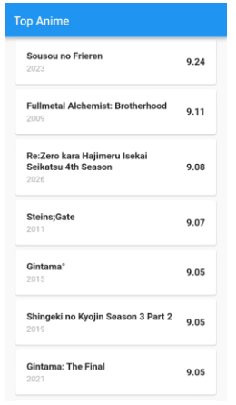

# Pertemuan 5 — API

## I. Tujuan

1. Memahami konsep dasar REST API (_Request_, _Response_, _Endpoint_, JSON)
2. Mampu menyiapkan API _handler_ (_Repository_) menggunakan _package_ `http`
3. Menampilkan data dinamis, lengkap dengan _loading state_ dan _error handling_

---

## II. Teori

### 1. Apa itu API?

API adalah singkatan dari **Application Programming Interface**, merupakan jembatan atau perantara yang memungkinkan dua sistem komputer (aplikasi) yang berbeda untuk saling berbicara dan bertukar data, tanpa harus tahu kerumitan internal masing-masing.

Mari kita gunakan analogi yang paling umum: Restoran. Bayangkan Kita (Aplikasi Flutter) datang ke sebuah restoran. Kita tidak bisa langsung masuk ke dapur (_Database Server_) dan mengambil makanan sendiri. Kita butuh perantara.

- **Kita (_Client_)**: Ini adalah aplikasi Flutter kita, AnimeVerse.
- **Dapur (_Server/Database_)**: Ini adalah _database_ MyAnimeList (MAL) di suatu tempat di _internet_ yang menyimpan jutaan data anime.
- **Pelayan (API)**: Ini adalah Jikan API. Dialah yang menjadi perantara. Kita memberikan pesanan kepada pelayan, dan pelayan yang akan mengambilkannya dari dapur untuk Kita.
- **Menu (Dokumentasi API)**: Ini adalah dokumen panduan (https://tenrai.org/) yang memberi tahu Kita "pesanan" apa saja yang tersedia (misal: "Top Anime", "Search Anime", dll.) dan bagaimana cara memesannya.

**Kenapa kita membutuhkannya?**

1. **Pemisahan Tugas (_Separation of Concerns_)**: Dapur tidak perlu pusing memikirkan bagaimana tampilan meja Kita (UI/UX). Tugasnya hanya memasak. Aplikasi kita (_Client_) juga tidak perlu pusing bagaimana data anime disimpan di _database_. Tugas kita hanya menampilkan data itu dengan cantik. API memfasilitasi pemisahan tugas ini.
2. **Keamanan**: Kita tidak diizinkan masuk ke dapur. Ini adalah area terlarang. API memastikan bahwa _client_ (aplikasi kita) hanya bisa mengakses data yang "diizinkan" oleh _server_ (dapur), sesuai aturan di "menu" (dokumentasi).
3. **Sumber Data Terpusat**: Bayangkan jika data 10.000 anime disimpan di dalam aplikasi Kita. Ukuran aplikasi akan membengkak! Dengan API, data tetap di _server_. Aplikasi kita tetap ringan dan hanya mengambil data saat dibutuhkan.

**API jenis apa yang akan kita gunakan?**

Ada banyak jenis API, tapi yang paling dominan di dunia web dan mobile saat ini adalah **REST API** (_Representational State Transfer_).

REST bukanlah _tools_ atau _software_, melainkan gaya arsitektur (aturan main) tentang bagaimana API seharusnya dibuat. REST API menggunakan protokol standar HTTP—yang akan kita bahas di poin berikutnya—untuk berkomunikasi.

**Singkatnya**:

- API adalah konsep "pelayan"-nya.
- REST adalah "standar operasional" (SOP) si pelayan dalam melayani tamu.

Di modul ini, kita akan mengubah aplikasi AnimeVerse kita: dari yang tadinya mengambil data dari `dummy_data.dart`, menjadi aplikasi yang "memesan" data _real-time_ dari "dapur" Jikan API.

### 2. Siklus Request & Response (HTTP)

Jika **API** adalah "pelayan" (seperti di poin 1), maka **HTTP** (_HyperText Transfer Protocol_) adalah bahasa dan aturan yang digunakan pelayan itu untuk berkomunikasi antara Kita (Aplikasi) dan Dapur (_Server_).

Proses ini selalu berjalan dalam satu siklus yang disebut _Request/Response_.

**1. _Request_ (Permintaan)**

Ini adalah "pesanan" yang Kita berikan kepada pelayan (API). Saat aplikasi kita ingin data, ia menyusun sebuah _Request_.

_Request_ ini pada dasarnya adalah pesan teks yang memiliki dua komponen utama yang akan kita gunakan:

- **Method (Kata Kerja)**: Apa yang ingin Kita lakukan?
  - **GET**: Membaca atau Mengambil data. (Contoh: "Pelayan, tolong ambilkan saya daftar top anime.")
  - **POST**: Membuat data baru.
  - **PUT**: Mengubah data yang sudah ada.
  - **DELETE**: Menghapus data.
- **_Endpoint_ (URL)**: Ke "alamat" mana Kita mengirim permintaan ini? Ini adalah "meja" atau "dapur" spesifik yang dituju.
  - Contoh: `https://api.tenrai.org/v1/top/anime`

Jadi, _Request_ kita jika diterjemahkan: "Hei Jikan API, saya mau _GET_ data dari alamat `/top/anime`."

**2. _Response_ (Tanggapan)**

Setelah pelayan (API) memproses pesanan Kita ke dapur (_Server_), ia akan kembali membawa _Response_.

_Response_ ini juga memiliki dua komponen utama yang wajib kita periksa:

- **Status Code (Kode Status)**: Apakah pesanan Kita berhasil? Ini adalah angka yang memberi tahu kita hasil dari _request_ tadi. Kita wajib tahu 3 kode ini:
  - **200 OK**: Berhasil. Pesanan Kita (data) ada di dalam _body_.
  - **404 _Not Found_**: Gagal. Alamat (_endpoint_) yang Kita tuju tidak ditemukan.
  - **500 _Internal Server Error_**: Gagal. "Dapur"-nya (_server_) sedang bermasalah.
- **Body (Isi)**: Ini adalah "makanan" atau data yang Kita minta.
  - Jika _status code_ 200 OK, _body_ akan berisi data yang kita inginkan. Dalam kasus REST API modern, data ini hampir selalu dalam format JSON—yang akan kita bahas di poin berikutnya.

Siklusnya sederhana: Aplikasi kita mengirim _Request_ GET ke _Endpoint_ Jikan, lalu kita menunggu _Response_. Jika _Status Code_-nya 200, kita ambil data dari _Body_ untuk diolah. Jika tidak, kita tangani sebagai _error_.

### 3. JSON (_JavaScript Object Notation_)

Kita sudah tahu:

- **API** adalah "pelayan" kita.
- **HTTP _Request_** adalah "pesanan" kita (_Method_: GET).
- **HTTP _Response_** adalah "tanggapan" dari pelayan.

Sekarang, kita bahas JSON. Jika _response_ dari pelayan (API) memiliki _Status Code_ 200 OK, maka di dalam _Body_-nya akan ada data yang kita minta. Tapi, dalam format apa? Jawabannya adalah **JSON**.

**JSON** adalah singkatan dari _JavaScript Object Notation_. Tapi jangan terkecoh dengan namanya, JSON adalah format data berbasis teks yang sangat ringan dan mudah dibaca manusia. Ini adalah standar _de facto_ (bahasa universal) bagi REST API untuk mengirim dan menerima data.

Dalam analogi restoran kita: JSON adalah struk belanja atau catatan pesanan yang diterima oleh dapur. Formatnya standar, jelas, dan semua orang (Aplikasi Flutter, _Server_, _Web_, dll.) bisa membacanya.

**Struktur Dasar JSON**

JSON hanya mengenal dua struktur utama:

1. **`{ }` Kurung Kurawal (Objek)**: Mewakili sebuah Objek. Ini adalah kumpulan pasangan _key-value_ (kunci-nilai).

   Contoh: `{"title": "Death Note", "score": 8.62}`

2. **`[ ]` Kurung Siku (_Array_)**: Mewakili sebuah List atau _Array_ (kumpulan data).

   Contoh: `["Shounen", "Mystery", "Supernatural"]`

**Membedah JSON dari Jikan API**

Saat kita meminta `/top/anime` ke Jikan API, kita akan mendapatkan _response body_ yang terlihat seperti ini (disederhanakan):

```json
{
  "data": [
    {
      "mal_id": 0,
      "url": "string",
      "images": { ... },
      "trailer": { ... },
      "approved": true,
      "titles": [ ... ],
      "title": "string",
      "title_english": "string",
      "title_japanese": "string"
    }
  ]
}
```

Tugas kita di modul ini adalah: Mengubah (disebut juga "_Parsing_") teks JSON di atas menjadi `List<Anime>` yang bisa dimengerti oleh aplikasi Flutter kita.

Sekarang kita tahu apa yang kita minta (API), bagaimana cara mintanya (HTTP), dan apa bentuk datanya (JSON).

Tapi ada satu masalah: mengambil data dari internet (API) itu butuh waktu. Aplikasi kita tidak bisa "berhenti" atau _freeze_ hanya untuk menunggu data datang. Di sinilah konsep terpenting Dart untuk modul ini berperan: **`Future`**.

### 4. _Asynchronous_: `Future`, `async`, dan `await` di Dart

Kita sudah tahu bahwa meminta data dari API (melakukan _request_ HTTP) butuh waktu. Waktu ini tidak bisa diprediksi. Bisa jadi 100 milidetik (cepat) atau 5 detik (lambat, karena jaringan jelek).

Sekarang, bayangkan apa yang terjadi jika aplikasi kita berhenti dan menunggu (disebut _blocking_) sampai data itu datang? UI akan _freeze_. Pengguna tidak bisa _scroll_, tidak bisa menekan tombol. Aplikasi akan terlihat "macet" dan _not responding_. Ini adalah pengalaman pengguna (UX) yang sangat buruk.

Untuk mengatasi ini, Dart menggunakan _concurrency model_ berbasis _Asynchronous Programming_.

**Konsep _Asynchronous_**

- **_Synchronous_ (Sinkron)**: "Kerjakan tugas A. Setelah A selesai, baru kerjakan tugas B. Setelah B selesai, baru kerjakan tugas C." Ini adalah _blocking_.
- **_Asynchronous_ (Asinkron)**: "Kerjakan tugas A (misal: ambil data API). Sambil menunggu A selesai, kamu boleh mengerjakan tugas B (misal: merespons _user_ yang sedang _scroll_). Nanti kalau A sudah selesai, kabari saya." Ini adalah _non-blocking_.

**Tiga Konsep Utama _Asynchronous_ di Dart:**

Untuk membuat kode _asynchronous_ ini terlihat rapi dan mudah dibaca (seperti kode _synchronous_), Dart menyediakan tiga _keywords_ utama:

1. **`Future<T>`**

   `Future` adalah sebuah objek yang mewakili "janji" bahwa sebuah nilai (bertipe T) akan tersedia di masa depan (_future_).

   Saat Kita memanggil fungsi yang mengambil data API (misal: `getTopAnime()`), fungsi itu tidak akan langsung mengembalikan `List<Anime>`. Itu tidak mungkin, karena butuh waktu.

   Sebagai gantinya, fungsi itu akan langsung mengembalikan sebuah "tanda terima" atau "janji" yang disebut `Future<List<Anime>>`.

   `Future` ini memiliki dua kemungkinan hasil akhir:
   - **Selesai (_Completed_)**: "Janji" ditepati. Ia kembali membawa data yang Kita minta (yaitu `List<Anime>`).
   - **_Error_**: "Janji" gagal. Ia kembali membawa sebuah _error_ (disebut _Exception_, misal: "tidak ada koneksi internet").

2. **`async`**

   _Keyword_ `async` digunakan untuk menandai sebuah fungsi bahwa fungsi tersebut akan melakukan pekerjaan _asynchronous_.

3. **`await`**

   _Keyword_ `await` adalah "jurus" yang paling penting. `await` hanya bisa digunakan di dalam fungsi yang sudah ditandai `async`. Tugas `await` adalah menunggu sebuah `Future` selesai, tanpa "nge-_block_" aplikasi.

   Saat kode Kita bertemu `await`, ia akan berkata: "Oke, saya akan _pause_ eksekusi fungsi ini di baris ini. Sambil menunggu `Future` ini selesai, silakan (Flutter) kerjakan hal lain seperti _rendering_ UI atau animasi. Kalau `Future`-nya sudah selesai (dapat data atau _error_), bangunkan saya lagi dan lanjutkan eksekusi dari sini."

Kita akan menggunakan pola `async`, `await`, dan `try-catch` ini di Bagian IV (Praktik) saat membuat _Repository_.

---

## III. Persiapan

### 1. Design Aplikasi

Aplikasi yang akan dibuat memiliki halaman utama dengan judul Top Anime. Pada halaman ini, daftar anime ditampilkan menggunakan ListView, dengan setiap item berupa Card.

Informasi yang ditampilkan pada setiap card meliputi:

- Title: Judul anime.
- Year: Tahun rilis anime.
- Score: Skor atau penilaian anime yang diberikan oleh sumber data.



### 2. Installasi Package

- **`http`**: Ini adalah _package_ resmi dari Dart Team. Tugasnya adalah memberi kita _tools_ dasar untuk melakukan _request_ HTTP (seperti GET, POST, dll.) ke API.

  ```bash
  flutter pub add http
  ```

## III. Praktik

### 1. Model Anime

Langkah pertama adalah membuat model untuk merepresentasikan data anime yang diterima dari API.

Model merupakan representasi struktur data dalam bentuk objek Dart. Dengan menggunakan model, data JSON dapat dikonversi menjadi objek yang memiliki atribut dengan tipe data yang jelas. Hal ini memudahkan proses pengolahan dan pemanggilan data di berbagai bagian aplikasi.

`models/anime.dart`

```dart
class Anime {
  final int malId;
  final String title;
  final int year;
  final double score;

  Anime({
    required this.malId,
    required this.title,
    required this.year,
    required this.score,
  });

  // Factory constructor untuk maping JSON dari API
  factory Anime.fromJson(Map<String, dynamic> json) {
    return Anime(
      // Type Casting tipe data
      malId: json['mal_id'] as int,
      title: json['title'] as String,
      year: json['year'] as int,
      score: (json['score'] as num).toDouble(),
    );
  }
}
```

Constructor factory ini bertugas mengonversi data berbentuk Map<String, dynamic> menjadi objek Anime. Nama properti JSON, seperti mal_id, dipetakan ke atribut Dart, yaitu malId. Sekaligus juga menyaring data atribut yang diperlukan

### 2. Anime Repository

Setelah model selesai dibuat, langkah selanjutnya adalah membuat repository untuk mengambil data dari Tenrai API.

Repository bertanggung jawab mengelola proses pengambilan data dari sumber eksternal. Dengan memisahkan proses komunikasi API dari tampilan aplikasi, kode menjadi lebih terstruktur dan lebih mudah dipelihara.

`repository/anime_repository`

```dart
import 'package:http/http.dart' as http;

class AnimeRepository {

  static const String _baseUrl = 'https://api.tenrai.org/v1';
  final http.Client _client = http.Client();

  // Asynchronus Method
  Future<List<Anime>> getTopAnime({int page = 1}) async {
    try {
      // Request ke server
      final response = await _client.get(Uri.parse('$_baseUrl/top/anime?page=$page'));

      if (response.statusCode == 200) {
        // Mapping
        final Map<String, dynamic> decodedData = jsonDecode(response.body);
        // Filter 'data'
        final List<dynamic> animeList = decodedData['data'];

        // Mapping ke model anime sekaligus ambil atribut tertentu
        return animeList.map((json) => Anime.fromJson(json)).toList();
      } else {
        throw Exception('Gagal memuat Top Anime. Status: ${response.statusCode}');
      }
    } catch (e) {
      throw Exception('Terjadi kesalahan jaringan: $e');
    }
  }
}
```

### 3. Anime Card

Setelah data dapat diambil dan dikonversi menjadi objek, kita akan membuat widget untuk menampilkan informasi setiap anime.

`widgets/anime_card.dart`

```dart
import 'package:flutter/material.dart';
import '../models/anime.dart';

class AnimeCard extends StatelessWidget {
  final Anime anime;
  const AnimeCard({
    super.key,
    required this.anime
  });

  @override
  Widget build(BuildContext context) {
    final screenWidth = MediaQuery.of(context).size.width;
    final screenHeight = MediaQuery.of(context).size.height;
    return Card(
      margin: EdgeInsets.symmetric(
        vertical: screenHeight * 0.005,
        horizontal: screenWidth * 0.05
      ),
      child: Padding(
          padding: EdgeInsets.all(screenWidth * 0.05),
          child: Row(
            children: [
              Expanded(
                  child: Column(
                    crossAxisAlignment: CrossAxisAlignment.start,
                    children: [
                      Text(
                          anime.title,
                          style: TextStyle(
                            fontSize: 16,
                            fontWeight: FontWeight.bold
                          ) ,
                      ),
                      SizedBox(height: screenWidth * 0.01),
                      Text(
                        '${anime.year}',
                        style: TextStyle(
                            fontSize: 14,
                            color: Colors.grey
                        ) ,
                      ),
                    ],
                  )
              ),
              SizedBox(width: screenWidth * 0.05),
              Text(
                '${anime.score}',
                style: TextStyle(
                    fontSize: 16,
                    fontWeight: FontWeight.bold
                ) ,
              ),
            ],
          ),
      ),
    );
  }
}

```

### 4. Anime List

Selanjutnya, kita akan membuat widget yang bertanggung jawab menampilkan daftar anime berdasarkan hasil request dari repository.

Pada tahap ini, kita menggunakan FutureBuilder untuk menangani hasil proses asinkron dan ListView.builder untuk membangun daftar anime secara efisien.

`widgets/anime_list.dart`

```dart
import 'package:flutter/material.dart';
import '../models/anime.dart';
import 'anime_card.dart';

class AnimeList extends StatelessWidget {
  final Future<List<Anime>> futureAnimes;

  const AnimeList({
    super.key,
    required this.futureAnimes,
  });

  @override
  Widget build(BuildContext context) {
    return FutureBuilder<List<Anime>>(
      future: futureAnimes,
      // Snapshot -> Menampung Status proses asinkronus
      builder: (context, snapshot) {
        print(snapshot.connectionState);
        if (snapshot.connectionState == ConnectionState.waiting) {
          return const Center(
            child: CircularProgressIndicator(),
          );
        }

        if (snapshot.hasError) {
          print('Detail Error: ${snapshot.error}');
          return const Center(
            child: Text('Gagal memuat data anime.'),
          );
        }

        final animes = snapshot.data ?? <Anime>[];

        if (animes.isEmpty) {
          return const Center(
            child: Text('Tidak ada anime.'),
          );
        }

        return ListView.builder(
          itemCount: animes.length,
          itemBuilder: (context, index) {
            final anime = animes[index];

            return AnimeCard(
              key: ValueKey(anime.title),
              anime: anime,
            );
          },
        );
      },
    );
  }
}
```

### 5. Home Screen

Tahap terakhir adalah menggabungkan repository dan widget yang telah dibuat ke dalam halaman utama aplikasi.

Halaman ini bertanggung jawab memulai proses pengambilan data ketika pertama kali dibuat, kemudian meneruskan hasil Future kepada widget AnimeList.

`widgets/home_screen.dart`

```dart
class HomeScreen extends StatefulWidget {
  const HomeScreen({super.key});

  @override
  State<HomeScreen> createState() => _HomeScreenState();
}

class _HomeScreenState extends State<HomeScreen> {
  final AnimeRepository _repository = AnimeRepository();
  late Future<List<Anime>> _futureAnimes;

  @override
  void initState() {
    super.initState();
    // 2. Panggil API tepat saat layar pertama kali dimuat
    _futureAnimes = _repository.getTopAnime();
  }

  @override
  Widget build(BuildContext context) {
    return Scaffold(
      appBar: AppBar(
        title: const Text('Top Anime'),
      ),
      body: AnimeList(
        futureAnimes: _futureAnimes,
      ),
    );
  }
}
```
